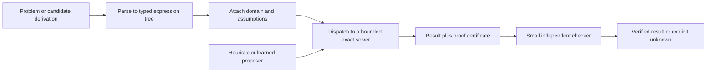

# Lancius Mathematics Engine: Research and Development Plan

**Purpose:** establish a comprehensive, staged plan for making Lancius’s mathematical reasoning more accurate, explainable, and resource-efficient.

**Starting-point snapshot:** 2026-11-24. The I6 architecture notes below
describe the historical baseline recorded on that date. V1.2-RC3.4 publishes
a later model with a different sparse input schema and held-out
training/evaluation contract; see
[`generation_1/I6/README.md`](../generation_1/I6/README.md) for its current
implementation and measurements.

**Status:** research plan. It records directions to investigate and criteria for choosing them; it does not claim that the proposed algorithms have been implemented or benchmarked.

## 1. Goal

Build a mathematics engine that can solve and check supported problems with exact arithmetic, explain each transformation, and reject or abstain on work outside its supported domain. Keep the trusted checker small. Let more complicated routines propose answers or proof steps, then require the checker to validate a compact certificate.

For known, formalized mathematics, use the domain algorithm as the source of the result. Use learned or heuristic methods for parsing, candidate generation, and prioritizing work. Keep them outside the final trust boundary.

The aim is a strong collection of dependable methods for specific mathematical domains. A single procedure that decides every mathematical theorem is not an achievable target: first-order logic is undecidable in general ([Church’s theorem](https://plato.stanford.edu/entries/goedel-incompleteness/)). Each solver therefore needs a stated domain, assumptions, resource limit, and failure mode.

## 2. Current starting point

- [`tools/prm/algos.py`](../tools/prm/algos.py) defines the original mathematical workload with exact `Fraction` values and canonical derivation steps. The verifier lineage has expanded this into 150 algorithms across algebra, calculus, linear algebra, and number theory.
- [`tools/prm/verifier5.py`](../tools/prm/verifier5.py) computes exact step agreement and structural agreement, then emits measurements used by the I6 training corpus.
- The 2026-11-24 I6 baseline used a 65 → 4096 → 2560 → 5 network with 10,771,461 parameters per family expert. RC3.4 uses 65 → 128 → 64 → 5 with seven semantic inputs and 17,029 parameters per expert, fresh initialization, and algorithm-held-out splits. See [`generation_1/I6/README.md`](../generation_1/I6/README.md).
- The 2026-11-24 I6 feature schema changed coordinate 57 from `mean_rel` to `n_wrong`; the earlier I1–I3 models retain the old meaning. RC3.4 has a separate sparse feature-generation path and rejects incompatible I3 warm starts. Preserve this separation in any new corpus, checkpoint, or evaluator.
- The retained I3 normalizer is not a fitted I6 z-score for `n_wrong`. Existing model artifacts depend on their training transform. Future model formats should identify the feature schema and normalizer explicitly.
- Prior saved-model continuous-error claims were audited and withdrawn. Any new algorithm should be compared with exact, per-row measurements on a fixed evaluation set; no score should be inferred from argmax accuracy or from `MAE²`.

## 3. Target architecture

### Trust boundary

1. **Parser and type checker:** determine whether a symbol denotes an integer, rational, real approximation, matrix, modular residue, or proposition. Preserve the distinction between these domains.
2. **Solver:** simplify, solve, or construct a proof. It may be optimized, heuristic, or eventually external.
3. **Certificate:** state the theorem, assumptions, rule identifiers, substitutions, premises, and conclusion for each step.
4. **Checker:** independently confirm each local inference and the final result using exact operations. A timeout, unsupported construct, failed precondition, or invalid certificate returns `unknown` or `invalid`; it never silently becomes a guessed answer.

Lean uses a related arrangement: tactics construct proof terms and a small kernel checks them. This is a useful architecture to study, without requiring Lancius to adopt Lean as a runtime dependency. [Lean kernel and proof-checking reference](https://lean-lang.org/doc/reference/latest/Elaboration-and-Compilation/)

## 4. Foundational mathematics to formalize

The first deliverable should be a versioned **mathematical contract**: exact definitions, preconditions, accepted input forms, and expected outputs for every supported rule. These are the rules the algorithms must preserve.

### 4.1 Logic and equality

Implement the inference rules used by every later domain:

- Equality: reflexivity, symmetry, transitivity, and congruence.
- Substitution: replace equals with equals only in a well-typed context.
- Propositional logic: conjunction/disjunction introduction and elimination, implication, modus ponens, negation, and contradiction.
- Quantifiers: variable binding, capture-avoiding substitution, and explicit universal instantiation where supported.
- Equivalence: record both directions when a transformation is reversible; record a one-way implication when it is not.

Every rule has a small checker and a certificate form. A proof step should identify the rule used rather than merely show two strings that appear equal.

### 4.2 Arithmetic domains

Represent the domain in the expression itself:

- Integers \(\mathbb Z\).
- Rationals \(\mathbb Q\), represented as normalized \(p/q\), with \(q>0\).
- Modular integers \(\mathbb Z/n\mathbb Z\), with an explicit modulus.
- Real numbers represented by exact algebraic objects or by certified intervals when needed.
- Floating point as a separate finite-precision domain, never as an implicit substitute for exact real arithmetic.

Core laws include the semiring/ring laws, field laws when division is allowed, order laws, and the domain-specific rules for modular arithmetic. Division, square roots, logarithms, and inequality transformations must carry their preconditions.

Examples of preconditions that must be represented:

- Dividing both sides by \(a\) requires \(a\ne0\).
- Multiplying an inequality by a negative value reverses its direction.
- Cancelling a factor requires proving it is nonzero.
- \(\sqrt{x}\) over the reals requires \(x\ge0\).
- Reducing a congruence or taking a modular inverse depends on the modulus and, for inverses, coprimality.

### 4.3 Algebra identities and equations

Prioritize identities already represented in the corpus, then expand by demand:

- Linear equation: \(ax+b=c\), with explicit cases for \(a=0\).
- Quadratic formula and discriminant: \(D=b^2-4ac\), \(x=(-b\pm\sqrt D)/(2a)\), with \(a\ne0\) and real-domain checks.
- Difference of squares, perfect-square trinomials, sums/differences of cubes, binomial theorem, and polynomial expansion.
- Arithmetic and geometric sequences and finite sums.
- Polynomial equality and factorization over a declared coefficient domain.
- Rational-expression equality, with denominator restrictions retained.

### 4.4 Number theory

- Euclidean algorithm for \(\gcd(a,b)\).
- Extended Euclidean algorithm for Bézout coefficients \(ax+by=\gcd(a,b)\).
- Divisibility, prime-factor checks within a bounded range, congruences, and modular inverses.
- Modular exponentiation by repeated squaring.
- Integer square-root and perfect-square checks.
- Later: stronger primality/factorization algorithms only if a real workload requires them.

### 4.5 Linear algebra

- Row operations and their effect on the solution set.
- Gaussian elimination for small rational systems, including pivoting, rank, consistency, and free variables.
- Determinant, inverse, nullspace, dot product, matrix-vector product, and matrix identities.
- For integer matrices, evaluate fraction-free Bareiss elimination before standard rational elimination. Its updates use exact divisions and can avoid large intermediate fractions; FLINT’s algorithm notes give a useful implementation reference, alongside Bareiss’s original paper. [Bareiss paper](https://doi.org/10.1090/S0025-5718-1968-0226829-0), [FLINT fraction-free elimination](https://flintlib.org/doc/algorithms/linear-algebra/fraction-free.html).

### 4.6 Calculus

Start with the parts having small exact checkers:

- Derivative of constants, sums, products, quotients, integer powers, and compositions.
- Polynomial derivatives and exact polynomial antiderivatives.
- Definite polynomial integrals by evaluating an antiderivative at the endpoints.
- Basic limit rules only with explicit side conditions.
- Fundamental theorem of calculus in a formal statement with its continuity/integrability assumptions.

General antiderivatives, transcendental identities, and unrestricted limits are a later research area. They require stronger domain and branch-cut semantics than the polynomial cases.

### 4.7 Probability and inequalities

- Counting and finite sums using exact integers/rationals.
- Conditional probability, complement, total probability, Bayes’ theorem, and expectation for finite distributions.
- Order transitivity, triangle inequality, sign-aware multiplication, AM–GM, Cauchy–Schwarz, and Pythagorean identities.
- Separate a proof of an inequality from a numerical approximation to its two sides.

## 5. Candidate algorithms and when to use them

| Method | Best use | Accuracy and cost considerations | Priority |
|---|---|---|---|
| Exact rational evaluation | Arithmetic and finite derivations | Exact results; cost grows with integer bit-length. | Immediate |
| Canonical polynomial form | Polynomial identities and equality | Store monomials in a fixed variable order and combine coefficients. Expression expansion can grow rapidly, so cap terms and bit-length. | Immediate |
| Oriented rewrite rules | Simplifying expressions and checking steps | Cheap and explainable when each rewrite decreases a well-founded measure. Unrestricted bidirectional rules can loop. | Immediate |
| Horner evaluation | Evaluating polynomials | Linear in polynomial degree with fewer multiplications and less intermediate growth than naive evaluation. | Immediate |
| Euclid / extended Euclid | GCD, divisibility, modular inverses | Very small memory; logarithmic number of division steps in input magnitude. | Immediate |
| Repeated squaring | Powers and modular powers | \(O(\log n)\) multiplications for exponent \(n\); check overflow or work in an explicit modular domain. | Immediate |
| Linear/quadratic solvers | Common equation classes | Constant-size logic; enumerate degenerate coefficients and exact-root cases. | Immediate |
| Sparse exact Gaussian elimination | Small systems over \(\mathbb Q\) | Pivoting and sparsity matter; rational numerators/denominators may grow. | High |
| Bareiss fraction-free elimination | Integer matrices | Exact divisions can control fraction growth; requires correct pivot bookkeeping. | High |
| Interval arithmetic | Certified bounds for irrational or floating quantities | A result is an enclosure, not an exact equality. Use directed rounding and report interval width. | High when needed |
| SMT / DPLL(T) | Conjunctions of logic, equality, and supported arithmetic constraints | Reuses specialized decision procedures. Bound solver time and validate proof/counterexample output. SMT-LIB defines logics including linear integer/real arithmetic and bit vectors. [SMT-LIB standard](https://smt-lib.org/language.shtml), [supported logics](https://smt-lib.org/logics.shtml). | Medium |
| Equality saturation / e-graphs | Searching among equivalent expression forms | Can find useful simplifications without destructive rewrite order; e-graphs can grow quickly. Apply node/time limits and extract a proof path. [egg paper](https://doi.org/10.1145/3434304). | Later |
| Polynomial GCD / Gröbner bases | Multivariate polynomial equations and ideal membership | Potentially expensive; do not put in the small trusted core. Use only for demonstrated workloads, with checkable outputs. | Later |

For matrix and polynomial code, compare custom exact routines against mature arithmetic libraries such as GMP or FLINT before deciding whether to depend on them. The comparison must include build footprint, portability, license, memory, and certificate/checker requirements—not just speed.

### Questions to answer before choosing an implementation

1. **Is Lancius checking a known procedure or judging an unknown derivation?** For a known procedure, compare direct execution plus a proof certificate against the learned verifier. For unknown procedures, keep theorem search separate from certificate checking.
2. **Which mathematical domain is intended for each claim?** Establish whether each value is in the integers, rationals, reals, modular arithmetic, or floating point before selecting transformations.
3. **Which current failures are arithmetic failures, and which are parsing, semantic, feature, or training failures?** Preserve these as distinct failure codes and benchmark each separately.
4. **When does exact arithmetic become too expensive?** Measure operand bits and expression growth; choose a declared cutoff and a certified interval fallback rather than silent floating conversion.
5. **Which normal form works for each family?** Compare sparse polynomial collection, rational-function normalization, ordered rewriting, and later e-graph search. Do not force one normalizer on every domain.
6. **Which linear constraint fragment covers the next workload?** Compare simple substitution/elimination with Fourier–Motzkin or a bounded SMT solver. General integer/nonlinear arithmetic has different completeness and cost properties from rational linear arithmetic.
7. **Which library dependencies are acceptable?** Compare custom integers with GMP/FLINT for C integration; compare solver libraries only after certificate export and independent checking are demonstrated.
8. **What is the resource budget?** Set a per-problem time, memory, integer-bit, AST-node, and certificate-size limit before enabling more advanced search.

### Prototype and integration policy

- Prototype mathematical semantics in `tools/prm` using the existing exact-rational workflow and explicit proof records.
- Keep each algorithm callable independently so it can be cross-checked without training or running the full I6 pipeline.
- Port stable routines to C only when the runtime needs them and the certificate contract is settled.
- Preserve a small C checker for certificates even if a larger solver is added in Python, Lean, an SMT solver, or a computer-algebra library.
- Add a model or heuristic only for work that cannot be decided cheaply by a supported exact routine, such as candidate parsing or tactic selection.
- Version every rule set and certificate format. Version feature meanings and normalizers separately for any learned fallback.

## 6. Efficiency work to investigate

### 6.1 Exact rational arithmetic

- Benchmark eager reduction after every operation against delayed/cross-cancelled reduction.
- For multiplication \((a/b)(c/d)\), cancel \(\gcd(|a|,d)\) and \(\gcd(|c|,b)\) before multiplying.
- For addition, use the denominator gcd to form a least-common-denominator path instead of multiplying both denominators blindly.
- Track numerator/denominator bit-length, gcd count, and total big-integer allocations.
- If fixed-width C integers are used, detect overflow before it occurs. Never wrap and continue as if the result were exact.
- Compare a bounded built-in integer representation, GMP, and FLINT on the actual Lancius corpus before choosing a backend.

### 6.2 Expression representation

- Use a typed abstract syntax tree (AST) with explicit literals, symbols, operations, relations, and assumptions.
- Hash-cons repeated subexpressions into a DAG; memoize exact evaluations and normal forms.
- Represent polynomials sparsely as `(monomial, rational coefficient)` pairs with canonical ordering.
- Normalize signs, rational constants, and associative/commutative operators in one defined pass.
- Preserve original source spans and rewrite provenance so every normalized result can be explained.
- Add hard limits for AST nodes, polynomial terms, proof length, integer bits, and wall-clock work.

### 6.3 Rewrite safety

- Give each rewrite a formal rule name, typed signature, assumptions, and proof obligation.
- Orient basic rewrites toward a chosen normal form; prove or structurally enforce termination for each rule set.
- Keep transformations that are only implications distinct from equivalences.
- Never simplify across a denominator, square root, logarithm, absolute value, or inequality without retaining the relevant condition.
- Investigate e-graphs only after deterministic normal forms and rule certificates work. Equality saturation is a search structure, not a proof checker by itself.

### 6.4 Linear algebra and polynomial growth

- Compare rational elimination, fraction-free Bareiss, and modular methods on realistic matrix sizes and coefficient lengths.
- Select pivots that limit coefficient growth; preserve row permutation and sign in certificates.
- Use sparse storage when matrices are sparse; do not pay dense costs for zero entries.
- For polynomial expressions, measure term explosion before considering Gröbner bases or general expansion.
- Consider modular reconstruction for large integer determinants only after small-matrix Bareiss performance is measured.

### 6.5 Certified approximate mathematics

- Use exact rationals whenever the problem is rational.
- Use outward-rounded intervals for certified bounds, not a floating tolerance pretending to prove equality.
- Return “proved by interval” only when the enclosure establishes the required sign or containment; return “inconclusive” when it straddles the boundary.
- Treat algebraic roots as a later type: polynomial plus isolating interval, with exact root-count evidence if required.

## 7. Work phases and decision gates

### Phase 0 — Freeze the mathematical contract

**Deliverables:** theorem/rule catalogue; type/domain definitions; versioned feature schema; certificate format; unsupported-case behavior.

**Gate:** every current corpus label and every mathematical operation has a precise definition and explicit preconditions. I1–I3 and I6 feature schemas, normalizers, and saved-model metadata remain distinguishable.

### Phase 1 — Exact arithmetic kernel

Implement normalized rationals, exact comparison, integer division, gcd, powers, perfect-square checks, and explicit resource limits. Record bit-growth and allocation counters.

**Gate:** all arithmetic operations either return an exact result or an explicit failure. No overflow, failed division, or malformed rational can produce an accepted answer.

### Phase 2 — Proof certificates and small checker

Implement certificate records for arithmetic, equality, substitution, linear solving, and existing canonical steps. Keep the checker independent of the routine that generated the answer.

**Gate:** deliberately corrupted certificates are rejected. Valid certificates round-trip through serialization and are accepted by the checker.

### Phase 3 — High-value equation and identity modules

Implement linear equations, quadratics, polynomial identities, binomial expansion, arithmetic/geometric sums, and rational-expression checks. Compare canonical forms with step-by-step certificates.

**Gate:** exact results for all supported cases; explicit unknown for unsupported roots, invalid domains, and resource-limit cases.

### Phase 4 — Number theory and small linear algebra

Implement Euclid, extended Euclid, modular exponentiation/inverse, small-prime/perfect-square checks, row reduction, rank, determinant, and small-system solving. Benchmark Bareiss against ordinary rational elimination.

**Gate:** independently cross-check each solver; certificates preserve divisibility, pivot, rank, and permutation facts.

### Phase 5 — Calculus, probability, and inequalities

Implement exact finite probability first, then derivative rules and polynomial integration. Add inequality transformations with sign/domain conditions. Add certified intervals only where exact forms are insufficient.

**Gate:** each theorem checker validates its assumptions and exact result; interval cases report bounds and inconclusive outcomes honestly.

### Phase 6 — Bounded automation

Prototype SMT for supported linear arithmetic and equality constraints. Prototype equality saturation for expression simplification. Measure proof/certificate extraction costs and impose hard resource limits.

**Gate:** every accepted automated result is checked by the Lancius checker or a separately trusted checker. A timeout is not a proof of falsehood.

### Phase 7 — Optional model assistance

Keep any learned model as a parser, tactic selector, or candidate-step proposer. Feed its suggestions into the exact checker. Retain an explicit fallback to exact routines and an abstention result.

**Gate:** learned components cannot directly issue a mathematically verified verdict without a valid certificate.

## 8. Verification and benchmark protocol

This section specifies future evaluation; it does not report test runs.

### 8.1 Correctness tests

- Exhaustively enumerate small integer/rational inputs for each bounded rule.
- Generate random exact inputs independently of the solver implementation.
- Mutate one proof step at a time: sign, operator, denominator, pivot, exponent, omitted step, or assumption.
- Include degeneracies: zero coefficients, zero denominators, negative values, repeated roots, singular matrices, empty sums, modulus 1, non-coprime modular inverses, missing values, and long derivations.
- Use metamorphic checks: commutative rearrangement, equivalent fraction scaling, applying an identity then its inverse, and row operations that preserve a linear system.
- Cross-check selected cases with an independently implemented exact system. Never use the same generator logic as both the sole oracle and the implementation under test.

### 8.2 Dataset and generalization checks

- Preserve a fixed clean test set and exact row-level metrics.
- Report separate results for known algorithms, held-out parameter ranges, held-out algorithms, and held-out families.
- Distinguish step correctness, final-answer correctness, structural correctness, proof validity, and unsupported-case abstention.
- Evaluate the exact engine and I6 on identical cases with each model receiving its own versioned feature schema and normalization.
- Avoid using the synthetic distribution as evidence for unrestricted human-written proof competence.

### 8.3 Efficiency measurements

Record, by algorithm family and input size:

- Median and 95th-percentile runtime.
- Peak memory and allocation count.
- Integer/rational operand bit-length and polynomial term count.
- Number of rewrite steps, solver decisions, and certificate nodes.
- Checker time separately from solver time.
- Cold and warm cache results.
- Model parameters and inference operations for any learned fallback.

### 8.4 Acceptance rules

- **Soundness:** no false acceptance in the independent bounded test suite; all supported outputs carry checkable evidence.
- **Coverage:** unsupported inputs return a clear unknown/unsupported result, with no forced class.
- **Accuracy:** report exact answer and proof-step metrics separately; no MAE/MSE inferred from class accuracy.
- **Efficiency:** retain a method only if it improves latency, memory, coverage, or clarity for a measured workload.
- **Reproducibility:** version theorem rules, domains, feature schemas, normalizers, corpus generation, and benchmarks.

## 9. Risks and boundaries

- **Undecidability:** no general procedure can settle all first-order mathematical claims. Specialize to decidable fragments and bounded algorithms.
- **Domain confusion:** an integer, rational, real approximation, and modular residue obey different laws. Implicit conversion can make a valid-looking but false proof.
- **Unsound cancellation:** algebraic cancellation and inequality transformations require nonzero/sign assumptions.
- **Expression swell:** exactness can consume time and memory when numerators, denominators, or polynomial term counts grow. Use limits and explicit unknown results.
- **Shared-bug validation:** agreement with the same generator or checker is weak evidence. Keep independent oracles and mutation tests.
- **Feature-schema drift:** dimensions alone do not identify feature meaning. Store a schema ID and normalizer with every trained artifact.
- **Overclaiming:** success on the generated 150-algorithm corpus establishes competence on that formalized workload, not general mathematical reasoning.

## 10. Research references

These are starting references for the proposed workstreams, not endorsements of adopting the referenced software as a dependency.

1. [Lean language reference: kernel and proof checking](https://lean-lang.org/doc/reference/latest/Elaboration-and-Compilation/) — small trusted checker architecture.
2. [SMT-LIB language standard](https://smt-lib.org/language.shtml) and [logic catalogue](https://smt-lib.org/logics.shtml) — standard encodings and supported arithmetic/bit-vector fragments.
3. Erwin H. Bareiss, [“Sylvester’s Identity and Multistep Integer-Preserving Gaussian Elimination”](https://doi.org/10.1090/S0025-5718-1968-0226829-0), 1968 — fraction-free elimination.
4. [FLINT fraction-free elimination notes](https://flintlib.org/doc/algorithms/linear-algebra/fraction-free.html) — practical pivoting, exact division, and integer-growth details; cross-check implementation claims against the original paper.
5. Max Willsey et al., [“egg: Fast and Extensible Equality Saturation”](https://doi.org/10.1145/3434304), POPL 2021 — equality saturation and e-graphs for rewrite search.
6. [Church’s theorem overview](https://plato.stanford.edu/entries/goedel-incompleteness/) — boundary on general theorem decision procedures.

## 11. Immediate next actions

1. Freeze and document the mathematical domains and rule preconditions for the existing corpus.
2. Define a certificate format and a minimal independent checker for exact rational steps.
3. Implement and benchmark cross-cancelled rational arithmetic and sparse polynomial normalization.
4. Reproduce the current 150-algorithm workload with exact rule-based outputs and compare against I6.
5. Add Euclid/extended Euclid, modular exponentiation, linear solving, and small-matrix Bareiss as the first new algorithm set.
6. Build the independent correctness and resource benchmark suite before pursuing SMT, e-graphs, Gröbner bases, or broader calculus.

## Appendix A — Individual theorem and equation registry

This registry turns the broad math families into concrete rules with domains and checks. These are mathematical targets for a versioned engine contract. A formula appearing in the current synthetic corpus may be tested only on a small parameter range or a single instance; Appendix B lists those source descriptions individually.

### A.1 First rules for the trusted exact kernel

These rules are the highest priority because every later solver depends on them.

- **Equality reflexivity:** $a=a$. Check that both sides have the same typed expression.
- **Equality symmetry:** $a=b\Rightarrow b=a$. Reference the earlier equality and reverse its sides.
- **Equality transitivity:** $a=b\land b=c\Rightarrow a=c$. The middle terms must be the same typed expression.
- **Congruence:** $a=b\Rightarrow f(a)=f(b)$, only where $f$ is defined for both values in the declared domain.
- **Rational normalization:** represent $p/q$ with $q>0$ and $\gcd(|p|,q)=1$; normalize zero to $0/1$. Reject $q=0$.
- **Rational equality:** for $b,d\ne0$, $a/b=c/d\iff ad=bc$. Check by integer cross multiplication.
- **Rational addition and multiplication:** $a/b+c/d=(ad+bc)/(bd)$ and $(a/b)(c/d)=ac/(bd)$, with $b,d\ne0$. Reduce without changing the value.
- **Rational division:** $(a/b)/(c/d)=ad/(bc)$, requiring $b,d,c\ne0$. The divisor must be nonzero.
- **Euclidean division:** for integer $a$ and positive integer $b$, there are unique integers $q,r$ with $a=qb+r$ and $0\le r<b$.
- **GCD remainder step:** $\gcd(a,b)=\gcd(b,a\bmod b)$ for $b\ne0$; stop at remainder zero and return a nonnegative gcd.
- **Bézout identity:** extended Euclid returns $x,y$ with $ax+by=\gcd(a,b)$. Verify this equality directly.
- **Divisibility cancellation:** if $d\mid ab$ and $\gcd(d,a)=1$, then $d\mid b$. Never cancel without the coprimality condition.
- **Congruence definition:** $a\equiv b\pmod m\iff m\mid(a-b)$, for integer $m>0$.
- **Modular inverse existence:** $a^{-1}\pmod m$ exists exactly when $\gcd(a,m)=1$. Verify a claimed inverse with $ax\equiv1\pmod m$.
- **Order under multiplication:** if $x<y$, multiplying by $c>0$ preserves the inequality; multiplying by $c<0$ reverses it; multiplying by zero makes both sides equal.

### A.2 Algebra equations and identities

- **Linear equation (`linear_solve`):** for $ax+b=c$, if $a\ne0$, the unique solution is $x=(c-b)/a$. If $a=0$, there are all solutions when $b=c$ and no solutions otherwise; the current routine covers only $a\ne0$.
- **Two-equation sum/difference system (`substitution_system`):** $x+y=S,\ x-y=D$ gives $x=(S+D)/2,\ y=(S-D)/2$. Substitute both answers into both original equations.
- **Quadratic formula (`quadratic_formula`):** for $ax^2+bx+c=0$ and $a\ne0$, let $\Delta=b^2-4ac$; then $x=(-b\pm\sqrt\Delta)/(2a)$. Over the reals, $\Delta<0$ means no real roots, $\Delta=0$ one repeated root, and $\Delta>0$ two roots. Current generated cases use rational perfect-square discriminants.
- **Quadratic Vieta identities:** if roots are $r_1,r_2$, then $r_1+r_2=-b/a$ and $r_1r_2=c/a$, for $a\ne0$.
- **Cubic Vieta identities (`vieta_cubic`):** if $a(x-r_1)(x-r_2)(x-r_3)=ax^3+bx^2+cx+d$, then $r_1+r_2+r_3=-b/a$, $r_1r_2+r_1r_3+r_2r_3=c/a$, and $r_1r_2r_3=-d/a$, for $a\ne0$.
- **Completing the square (`completing_square`):** $x^2+bx+c=(x+b/2)^2-(b^2/4-c)$.
- **Difference of squares (`difference_of_squares`):** $a^2-b^2=(a-b)(a+b)$.
- **Square of a sum (`perfect_square_trinomial`):** $(a+b)^2=a^2+2ab+b^2$; similarly $(a-b)^2=a^2-2ab+b^2$.
- **Cube of a sum (`cube_of_binomial`):** $(a+b)^3=a^3+3a^2b+3ab^2+b^3$; for a difference, the two middle terms have negative signs.
- **Sum of cubes (`sum_of_cubes`):** $a^3+b^3=(a+b)(a^2-ab+b^2)$.
- **Difference of cubes:** $a^3-b^3=(a-b)(a^2+ab+b^2)$.
- **Difference of powers (`power_difference`):** for integer $n\ge1$, $a^n-b^n=(a-b)\sum_{k=0}^{n-1}a^{n-1-k}b^k$.
- **Exponent laws (`expo_laws`):** for integers $m,n\ge0$, $a^ma^n=a^{m+n}$ and $(a^m)^n=a^{mn}$; negative exponents require $a\ne0$.
- **Binomial theorem (`binomial_expand`):** for integer $n\ge0$, $(x+y)^n=\sum_{k=0}^{n}\binom nk x^{n-k}y^k$, where $\binom nk=n!/(k!(n-k)!)$.
- **Arithmetic progression term and sum (`arithmetic_series`):** $a_k=a+(k-1)d$ and $\sum_{k=1}^{n}a_k=n(2a+(n-1)d)/2$, for integer $n\ge0$.
- **Geometric progression sum (`geometric_series`):** $\sum_{k=0}^{n-1}ar^k=a(r^n-1)/(r-1)$ for $r\ne1$; if $r=1$, the sum is $an$.
- **Gauss sum / triangular numbers:** $\sum_{k=1}^{n}k=n(n+1)/2$, for integer $n\ge0$.
- **Sum of squares (`sum_of_squares`):** $\sum_{k=1}^{n}k^2=n(n+1)(2n+1)/6$, for integer $n\ge0$.
- **Sum of cubes:** $\sum_{k=1}^{n}k^3=[n(n+1)/2]^2$, for integer $n\ge0$.
- **Sum of fourth powers (`sum_fourth_powers`):** $\sum_{k=1}^{n}k^4=n(n+1)(2n+1)(3n^2+3n-1)/30$, for integer $n\ge0$.
- **Sum of the first odd numbers (`sum_first_odds`):** $\sum_{k=1}^{n}(2k-1)=n^2$, for integer $n\ge0$.
- **Telescoping reciprocal sum (`telescoping_series`):** $\sum_{k=1}^{n}1/[k(k+1)]=n/(n+1)$ because $1/[k(k+1)]=1/k-1/(k+1)$.
- **Horner evaluation (`horner_eval`):** $a_3x^3+a_2x^2+a_1x+a_0=((a_3x+a_2)x+a_1)x+a_0$. The rewrite preserves value and reduces multiplications.
- **Factor theorem:** for polynomial $p$, $p(r)=0\iff(x-r)$ divides $p(x)$. Certificate: exact polynomial division with zero remainder.
- **Rational root theorem (`rational_root`):** for integer-coefficient $p(x)=a_nx^n+\cdots+a_0$, a reduced rational root $u/v$ must have $u\mid a_0$ and $v\mid a_n$, with $v>0$.
- **Partial fraction identity (`partial_fractions`):** for $a\ne b$ and $x\ne-a,-b$, $1/((x+a)(x+b))=[1/(b-a)](1/(x+a)-1/(x+b))$. The current workload checks selected values; the engine must check the symbolic identity and exclusions.
- **Affine composition (`composition_affine`):** if $f(x)=ax+b$ and $g(x)=cx+d$, then $(f\circ g)(x)=acx+ad+b$.
- **Inverse of a linear-fractional function (`inv_function_eval`):** for $f(x)=ax/(x+b)$ with $ab\ne0$, $f^{-1}(y)=by/(a-y)$, with $x\ne-b$ and $y\ne a$.
- **Absolute-value linear equation (`abs_linear`):** for $a\ne0$, $|ax+b|=c$ has two solutions $(c-b)/a$ and $(-c-b)/a$ if $c>0$, one if $c=0$, and none if $c<0$.
- **Ratio allocation (`ratio_share`):** if $p,q,r\ge0$ and $p+q+r>0$, splitting total $N$ in ratio $p:q:r$ gives $Np/(p+q+r),Nq/(p+q+r),Nr/(p+q+r)$; their sum is $N$.
- **Weighted mean bounds (`weighted_average`):** if $w_i\ge0$ and $\sum_iw_i>0$, then $\min_i v_i\le\sum_iw_iv_i/\sum_iw_i\le\max_i v_i$.
- **AM-GM for two nonnegative values:** $(x+y)/2\ge\sqrt{xy}$ for $x,y\ge0$, since $(\sqrt{x}-\sqrt{y})^2\ge0$. Equality holds exactly when $x=y$.
- **Cauchy-Schwarz:** for real vectors $u,v$, $(u\cdot v)^2\le(u\cdot u)(v\cdot v)$. The checker must establish the nonnegative difference, not just compare decimals.
- **Two-square product identity (`cauchy_identity`):** $(a^2+b^2)(c^2+d^2)=(ac+bd)^2+(ad-bc)^2$.

### A.3 Number-theory equations and tests

- **Least common multiple (`lcm_pair`):** for positive integers $a,b$, $\operatorname{lcm}(a,b)=ab/\gcd(a,b)$.
- **Modular exponentiation (`mod_pow_fast`):** maintain $r b^e\equiv a^{e_0}\pmod m$; for even $e$, square $b$ and halve $e$; for odd $e$, multiply $r$ by $b$ and decrement $e$. Require $m\ge2$ and $e\ge0$.
- **Fermat’s little theorem (`fermat_little`):** if $p$ is prime and $p\nmid a$, then $a^{p-1}\equiv1\pmod p$. This is not a primality test by itself.
- **Euler’s theorem:** if $\gcd(a,n)=1$, then $a^{\varphi(n)}\equiv1\pmod n$, where $\varphi(n)=|\{1\le k\le n:\gcd(k,n)=1\}|$.
- **Totient product formula:** if $n=\prod_i p_i^{e_i}$, then $\varphi(n)=n\prod_{p\mid n}(1-1/p)$, over the distinct prime divisors of $n$.
- **Wilson’s theorem (`wilson_check`):** integer $p>1$ is prime exactly when $(p-1)!\equiv-1\pmod p$. Direct factorial calculation is not efficient for large $p$.
- **Chinese remainder theorem (`crt_verify`):** for pairwise coprime positive moduli $m_i$, each residue tuple has one solution class modulo $M=\prod_i m_i$. Checking residues verifies a candidate; uniqueness also requires proving pairwise coprimality.
- **Modular inverse:** $ax\equiv1\pmod m$ has a solution iff $\gcd(a,m)=1$; extended-Euclid coefficients produce one.
- **Binomial coefficient recurrence (`pascal_row_mult`):** $\binom nk=\binom n{k-1}(n-k+1)/k$ for $1\le k\le n$; division is exact in integers.
- **Catalan numbers:** $C_n=\frac1{n+1}\binom{2n}{n}$ and $C_n=C_{n-1}\,2(2n-1)/(n+1)$ for $n\ge1$, with $C_0=1$.
- **Pythagorean triple identity (`pyth_triple_verify`):** for integers $m>n>0$, $(m^2-n^2)^2+(2mn)^2=(m^2+n^2)^2$. Primitivity additionally requires $\gcd(m,n)=1$ and opposite parity.
- **Perfect-square test (`perfect_square_check`):** for integer $N\ge0$, $N$ is a square iff $\lfloor\sqrt N\rfloor^2=N$. Negative integers are not integer squares.
- **Prime trial division:** integer $N>1$ is prime iff no integer $d$ with $2\le d\le\lfloor\sqrt N\rfloor$ divides it. A shorter divisor list is only a screen.
- **Divisor-square sum:** for distinct primes $p,q$ and $N=p^2q$, $\sum_{d\mid N}d^2=(1+p^2+p^4)(1+q^2)$. Distinctness matters because otherwise the divisor list changes.
- **Fibonacci recurrence:** $F_0=0,F_1=1,F_n=F_{n-1}+F_{n-2}$ for $n\ge2$. A finite run checks only a prefix.
- **Tribonacci recurrence:** $T_n=T_{n-1}+T_{n-2}+T_{n-3}$ for $n\ge3$, after all three initial values are specified.
- **Collatz iteration:** $T(n)=n/2$ for even $n$ and $T(n)=3n+1$ for odd $n$. A fixed number of steps proves only those steps, not that every positive integer reaches 1.

### A.4 Linear-algebra identities

- **Two-by-two determinant (`matrix_det_2x2`):** $\det\begin{pmatrix}a&b\\c&d\end{pmatrix}=ad-bc$.
- **Two-by-two inverse:** when $ad-bc\ne0$, $A^{-1}=\frac1{ad-bc}\begin{pmatrix}d&-b\\-c&a\end{pmatrix}$; verify $AA^{-1}=I=A^{-1}A$.
- **Cramer’s rule (`cramer_2x2`):** for $Ax=b$ with $\det A\ne0$, $x_i=\det(A_i)/\det(A)$. If $\det A=0$, analyze rank and consistency instead of dividing.
- **Gaussian row operations:** swapping rows, multiplying a row by nonzero $c$, or adding a multiple of one row to another preserves the solution set of the augmented system. Track row swaps and pivots.
- **Rank-nullity:** for a finite-dimensional domain $V$, $\dim V=\operatorname{rank}(A)+\operatorname{nullity}(A)$.
- **Determinant product:** for square matrices of the same size, $\det(AB)=\det(A)\det(B)$.
- **Cyclic trace:** for compatible finite matrices, $\operatorname{tr}(AB)=\operatorname{tr}(BA)$. This does not imply $AB=BA$.
- **Rank-one trace (`outer_trace`):** $\operatorname{tr}(uv^T)=v^Tu=u\cdot v$.
- **Two-dimensional Gram identity (`gram_det`):** $(u\cdot u)(v\cdot v)-(u\cdot v)^2=(u_1v_2-u_2v_1)^2\ge0$.
- **Parallelogram area (`area_parallelogram2`):** $\operatorname{area}=|u_1v_2-u_2v_1|$.
- **Projection onto a nonzero vector:** if $v\ne0$, $\operatorname{proj}_v(u)=\frac{u\cdot v}{v\cdot v}v$. Check that $u-\operatorname{proj}_v(u)$ is orthogonal to $v$.
- **Symmetric two-by-two eigenvalues (`eigen_sym`):** for $A=\begin{pmatrix}a&b\\b&d\end{pmatrix}$, $\lambda_{\pm}=(a+d\pm\sqrt{(a-d)^2+4b^2})/2$. Use an exact algebraic or interval type if the radicand is not a rational square.
- **Bareiss fraction-free update:** $a_{ij}^{(k+1)}=(a_{kk}^{(k)}a_{ij}^{(k)}-a_{ik}^{(k)}a_{kj}^{(k)})/a_{k-1,k-1}^{(k-1)}$, with initial previous pivot 1. Require exact division and handle zero pivots and singular matrices.

### A.5 Calculus theorems and numerical formulas

- **Constant and sum rules:** $(c)'=0$ and $(f+g)'=f'+g'$, where the derivatives exist.
- **Product rule (`product_rule`):** $(fg)'=f'g+fg'$.
- **Quotient rule (`quotient_rule`):** $(f/g)'=(f'g-fg')/g^2$, where $g\ne0$ on the domain.
- **Power rule (`power_rule`):** $\frac{d}{dx}x^n=nx^{n-1}$; the real-domain statement depends on $n$ and $x$, especially for negative or non-integer $n$.
- **Chain rule (`chain_rule`):** $(f\circ g)'(x)=f'(g(x))g'(x)$, when both derivatives exist.
- **Second derivative of a power:** $\frac{d^2}{dx^2}(ax^n)=an(n-1)x^{n-2}$, where the derivatives exist.
- **Power antiderivative:** for $n\ne-1$, $\int ax^n\,dx=ax^{n+1}/(n+1)+C$; for $n=-1$, use $a\ln|x|+C$ on intervals not crossing zero.
- **Definite power integral:** for $n\ne-1$, $\int_l^h ax^n\,dx=\frac{a}{n+1}(h^{n+1}-l^{n+1})$, if the integrand is defined and integrable on $[l,h]$.
- **Fundamental theorem of calculus:** if $F'=f$ on $[a,b]$ with the required continuity/integrability assumptions, $\int_a^b f(x)\,dx=F(b)-F(a)$.
- **Mean value theorem:** if $f$ is continuous on $[a,b]$ and differentiable on $(a,b)$, with $a<b$, some $c\in(a,b)$ satisfies $f'(c)=(f(b)-f(a))/(b-a)$.
- **Rolle’s theorem:** under the MVT conditions plus $f(a)=f(b)$, some $c\in(a,b)$ has $f'(c)=0$.
- **L’Hôpital’s rule:** for a differentiable quotient in a punctured interval, an applicable $0/0$ or $\infty/\infty$ form, and a suitable existing limit of $f'/g'$ with $g'\ne0$, $\lim f/g=\lim f'/g'$. This is not a general quotient rewrite.
- **Taylor polynomial:** $f(x+h)=\sum_{k=0}^{n}f^{(k)}(x)h^k/k!+R_{n+1}$. A certified approximation must also bound or identify the remainder.
- **Trapezoid exactness:** the one-panel trapezoid rule integrates every polynomial of degree at most 1 exactly.
- **Simpson exactness:** the one-panel Simpson rule integrates every polynomial of degree at most 3 exactly, with equal subintervals and the standard $1/3$ weights. Checking one quadratic does not prove this theorem.
- **Euler method recurrence:** $y_{k+1}=y_k+h f(x_k,y_k)$ and $x_{k+1}=x_k+h$. This defines a numerical method, not an exact solution in general; error bounds need regularity and step-size assumptions.
- **Newton square-root step:** for $N>0,x_k>0$, $x_{k+1}=\tfrac12(x_k+N/x_k)$. This is numerical unless exact divisibility or a certified interval argument applies.

### A.6 Probability and inequality rules

- **Probability normalization:** $P(\Omega)=1$, $P(A)\ge0$, and for disjoint events $A,B$, $P(A\cup B)=P(A)+P(B)$.
- **Complement and union:** $P(A^c)=1-P(A)$ and $P(A\cup B)=P(A)+P(B)-P(A\cap B)$.
- **Total probability:** for finite partition $B_1,\ldots,B_n$, $P(A)=\sum_iP(A\mid B_i)P(B_i)$; do not condition on an event of probability zero.
- **Bayes’ theorem:** when $P(B)>0$, $P(A\mid B)=P(B\mid A)P(A)/P(B)$. Store the event and conditioning direction explicitly.
- **Finite expectation:** $\mathbb E[X]=\sum_i x_iP(X=x_i)$ with probabilities nonnegative and summing to one; linearity gives $\mathbb E[aX+bY]=a\mathbb E[X]+b\mathbb E[Y]$.
- **Variance identity:** $\operatorname{Var}(X)=\mathbb E[X^2]-(\mathbb E[X])^2\ge0$, for a finite distribution with finite second moment.
- **Triangle inequality:** $|x+y|\le|x|+|y|$, for real or complex values.
- **AM-GM and Cauchy-Schwarz:** use the nonnegative/real-vector assumptions stated in A.2; check assumptions and prove the difference nonnegative.

### A.7 How the current 150 entries map to this registry

The source set contains 20 base entries, 12 I1 extensions, 68 further I1 entries, and 50 I3 additions: 150 identifiers total. The family counts are algebra 41, calculus 36, linear algebra 33, and number theory 40. Appendix B lists every identifier and its source-level mathematical description. Those descriptions locate the intended workloads; an exact sample is not a proof of the general statement written beside it.

Audit every entry before claiming theorem coverage:

1. Does the formula hold over the full stated domain, or only for the generator’s parameter range?
2. Are exceptional cases represented: zero denominators, repeated roots, negative radicands, singular matrices, non-coprime moduli, and empty sums?
3. Does the implementation check a symbolic identity or only selected numerical values?
4. Does its certificate prove the result, or only show that one candidate gives the expected number?
5. Is the item a theorem, recurrence, numerical method, finite computation, or test example? Keep those labels separate.

The first implementation tranche should be the Tier 0 arithmetic rules, linear and quadratic solving with degenerate cases, polynomial identities and factor checks, Euclid/Bézout/modular inverse, two-by-two exact linear algebra, and derivative/integral rules with their domains. Add other registry entries only behind an independently checked certificate and a measured workload.

## Appendix B — Existing corpus entries, one by one

This is a source-linked index of the exact 150 algorithm identifiers. Each description is copied or lightly condensed from the `math_desc` attached to that identifier in code; its source link leads to the full implementation. Treat it as the author’s intended workload description; verify it against the builder, step function, domain assumptions, and checker before promoting it to a general theorem. The source distribution is 20 base + 12 I1 + 68 extended I1 + 50 I3 entries.

### B.1 Algebra (41 entries)

- [`abs_linear`](../generation_1/I3/algos_i3.py) — `abs(a*x + b) = c has exactly the two solutions x=(c-b)/a and x=(-c-b)/a for c>0, a!=0.`
- [`am_gm_two`](../generation_1/I3/algos_i3.py) — `AM-GM on the pair (a, 4a): (a+4a)/2 >= sqrt(4a^2) = 2a, gap a >= 0.`
- [`arithmetic_series`](../tools/prm/algos.py) — `sum_{k=0}^{n-1} (a + k*d) = n*(2a + (n-1)d)/2.`
- [`binomial_coeff`](../generation_1/I1/algos_gen1_big.py) — `C(n,k) by multiplicative formula.`
- [`binomial_expand`](../tools/prm/algos.py) — `(x + y)^n = sum_k C(n,k) x^(n-k) y^k.`
- [`cauchy_identity`](../generation_1/I1/algos_gen1_big.py) — `(a^2+b^2)(c^2+d^2)=(ac+bd)^2+(ad-bc)^2.`
- [`completing_square`](../generation_1/I1/algos_gen1_big.py) — `x^2+bx+c = (x+b/2)^2-((b/2)^2-c).`
- [`composition_affine`](../generation_1/I3/algos_i3.py) — `f(x)=ax+b composed with g(x)=cx+d is (ac)x + (ad+b).`
- [`cube_of_binomial`](../generation_1/I1/algos_gen1_ext.py) — `(a+b)^3 = a^3+3a^2b+3ab^2+b^3.`
- [`difference_of_cubes`](../generation_1/I1/algos_gen1_ext.py) — `a^3 - b^3 = (a-b)(a^2+ab+b^2).`
- [`difference_of_squares`](../tools/prm/algos.py) — `a^2 - b^2 = (a - b)(a + b).`
- [`digit_sum_base`](../generation_1/I3/algos_i3.py) — `the base-b digit sum of N via the mod/div chain, exact for any base 2..8.`
- [`expo_laws`](../generation_1/I3/algos_i3.py) — `a^m * a^n = a^(m+n); verified exactly on small integer powers.`
- [`gauss_pairing`](../generation_1/I3/algos_i3.py) — `Gauss pairing: sum_{1..n} = (n/2)(n+1); both factor forms agree exactly.`
- [`geometric_mean_pair`](../generation_1/I3/algos_i3.py) — `GM of (sQ^2, s) equals sQ exactly; AM >= GM with gap (s(Q-1)^2 ... )/2 >= 0.`
- [`geometric_series`](../tools/prm/algos.py) — `sum_{k=0}^{n-1} a*r^k = a*(r^n - 1)/(r - 1), for r != 1.`
- [`horner_eval`](../generation_1/I1/algos_gen1_ext.py) — `p(x) = ((a3*x+a2)*x+a1)*x+a0.`
- [`inv_function_eval`](../generation_1/I3/algos_i3.py) — `f(x)=ax/(x+b) inverts to x = yb/(a-y), and the round trip is exact.`
- [`linear_recurrence`](../generation_1/I1/algos_gen1_big.py) — `u_n = p*u_{n-1}+q*u_{n-2}, three terms.`
- [`linear_solve`](../tools/prm/algos.py) — `a*x + b = c  =>  x = (c - b)/a, for a != 0.`
- [`log2_pow2`](../generation_1/I3/algos_i3.py) — `if N is a power of two, N = 2^k and k is the halving count.`
- [`log_product`](../generation_1/I1/algos_gen1_ext.py) — `log2(a*b) = log2(a)+log2(b), a,b powers of two.`
- [`median_five`](../generation_1/I3/algos_i3.py) — `median of five distinct numbers: two pair partitions leave three candidates; sum-min-max is the middle.`
- [`nested_radical`](../generation_1/I1/algos_gen1_big.py) — `(sqrt(a)+sqrt(b))^2 = a+b+2sqrt(ab).`
- [`partial_fractions`](../generation_1/I1/algos_gen1_big.py) — `1/((x+a)(x+b)) split verified at x0.`
- [`percentage_pair`](../generation_1/I3/algos_i3.py) — `q% of n is qn/100 and reversing recovers n exactly.`
- [`perfect_square_trinomial`](../tools/prm/algos.py) — `a^2 + 2ab + b^2 = (a + b)^2.`
- [`power_difference`](../generation_1/I1/algos_gen1_big.py) — `a^n-b^n = (a-b)*sum, n<=4.`
- [`quadratic_formula`](../tools/prm/algos.py) — `a*x^2 + b*x + c = 0  =>  x = (-b +- sqrt(b^2-4ac)) / (2a).`
- [`quartic_horner`](../generation_1/I1/algos_gen1_big.py) — `Degree-4 Horner in 3 stages.`
- [`ratio_share`](../generation_1/I3/algos_i3.py) — `N split in ratio p:q:r gives unit N/(p+q+r) and shares unit*p, unit*q, unit*r.`
- [`rational_root`](../generation_1/I1/algos_gen1_big.py) — `p(r)=0 via Horner for (x-r)(ax+b).`
- [`slope_from_points`](../tools/prm/algos.py) — `Through (x1,y1),(x2,y2): m = (y2-y1)/(x2-x1), b = y1 - m*x1, so y = m*x + b.`
- [`substitution_system`](../tools/prm/algos.py) — `x + y = S and x - y = D  =>  x = (S+D)/2, y = (S-D)/2.`
- [`sum_first_odds`](../generation_1/I3/algos_i3.py) — `the sum of the first n odd numbers is n^2: average (2n-1+1)/2 = n, times n terms.`
- [`sum_fourth_powers`](../generation_1/I1/algos_gen1_big.py) — `sum k^4 = n(n+1)(2n+1)(3n^2+3n-1)/30.`
- [`sum_odd`](../generation_1/I1/algos_gen1_big.py) — `Sum of first odds telescopes in partials.`
- [`sum_of_cubes`](../tools/prm/algos.py) — `a^3 + b^3 = (a + b)(a^2 - ab + b^2).`
- [`sum_of_squares`](../generation_1/I1/algos_gen1_ext.py) — `1^2 + ... + n^2 = n(n+1)(2n+1)/6.`
- [`vieta_cubic`](../generation_1/I1/algos_gen1_ext.py) — `For roots r1,r2,r3: sum, pairwise sum, product.`
- [`weighted_average`](../generation_1/I3/algos_i3.py) — `weighted mean (k1 v1 + k2 v2)/(k1 + k2) lies between v1 and v2, computed exactly.`

### B.2 Calculus (36 entries)

- [`area_under_linear`](../generation_1/I3/algos_i3.py) — `area under mx+c on [a,b]: m(b^2-a^2)/2 + c(b-a), exact.`
- [`asymptote_oblique`](../generation_1/I3/algos_i3.py) — `divide (Ax^2+Bx+C) by (x-d): quotient A x + (B+Ad), remainder C+d(B+Ad), vertical at d.`
- [`average_linear`](../generation_1/I1/algos_gen1_big.py) — `Average of a*x+b on [0,2] is a+b.`
- [`chain_poly`](../generation_1/I1/algos_gen1_big.py) — `d/dx (ax+b)^n at x0.`
- [`chain_rule`](../tools/prm/algos.py) — `d/dx (a*x^n + b) = a*n*x^(n-1); the constant b differentiates to 0.`
- [`concavity_quad`](../generation_1/I1/algos_gen1_big.py) — `f'' = 2a sign for a*x^2.`
- [`critical_cubic`](../generation_1/I3/algos_i3.py) — `critical points of x^3+ax^2+bx+c via the perfect-square discriminant of f'.`
- [`definite_integral`](../tools/prm/algos.py) — `int_lo^hi a*x^n dx = a/(n+1) * (hi^(n+1) - lo^(n+1)).`
- [`definite_quad`](../generation_1/I1/algos_gen1_big.py) — `int_0^1 (ax^2+bx+c).`
- [`euler_method_linear`](../generation_1/I3/algos_i3.py) — `Euler method for y'=kx, y(x0)=y0: two steps with rational h are exact.`
- [`ftc_check`](../generation_1/I1/algos_gen1_big.py) — `F(1)-F(0) for a*x^n.`
- [`harmonic_partial`](../generation_1/I1/algos_gen1_ext.py) — `H_n = sum_{k=1..n} 1/k exact, n <= 6.`
- [`implicit_circle`](../generation_1/I1/algos_gen1_big.py) — `Circle slope at (0,r) is 0.`
- [`inflection_cubic`](../generation_1/I1/algos_gen1_big.py) — `x^3+b*x inflects at 0.`
- [`inverse_slope`](../generation_1/I1/algos_gen1_big.py) — `Inverse slope 1/m.`
- [`lhopital_poly`](../generation_1/I1/algos_gen1_big.py) — `lim (x^2-a^2)/(x-a) = 2a.`
- [`monotonic_quad`](../generation_1/I1/algos_gen1_big.py) — `Derivative of a*x^2+x at 0 and 1.`
- [`mvt_quadratic`](../generation_1/I3/algos_i3.py) — `Mean value theorem for a quadratic: the tangent-slope point is exactly (p+q)/2.`
- [`newton_sqrt_step`](../generation_1/I3/algos_i3.py) — `one Newton step for sqrt(N): x1=(x0+N/x0)/2, kept exact because x0 | N.`
- [`power_rule`](../tools/prm/algos.py) — `d/dx (a*x^n) = a*n*x^(n-1).`
- [`power_rule_integrate`](../generation_1/I3/algos_i3.py) — `integral of c x^n over [0,B] is c B^(n+1)/(n+1), exact in rationals.`
- [`product_rule`](../tools/prm/algos.py) — `d/dx [ (a x^m)(b x^n) ] = a*m*b*x^(n+m-1) + a*b*n*x^(m+n-1).`
- [`quotient_rule`](../tools/prm/algos.py) — `d/dx [ u/v ] = (u'v - uv')/v^2, with u = a x^2 + b, v = c x + d evaluated at x = 1.`
- [`riemann_mid2`](../generation_1/I1/algos_gen1_big.py) — `2-rectangle midpoint of x^2 on [0,2].`
- [`rolle_check`](../generation_1/I3/algos_i3.py) — `f=A(x-p)(x-q): f vanishes at p,q and f' vanishes exactly at (p+q)/2, strictly between.`
- [`secant_poly_slope`](../generation_1/I3/algos_i3.py) — `secant slope of Ax^2+B between x1, x2 equals A(x1+x2) exactly.`
- [`second_derivative`](../generation_1/I1/algos_gen1_big.py) — `Second derivative of a*x^n at x0.`
- [`second_diff_central`](../generation_1/I3/algos_i3.py) — `central second difference of Ax^3 equals 6Ax exactly, the h^2 error term vanishing for cubics.`
- [`shadow_rates`](../generation_1/I1/algos_gen1_big.py) — `Similar-triangle shadow = 2h.`
- [`simpson_quadratic`](../generation_1/I3/algos_i3.py) — `Simpson's rule is exact for quadratics: S - I = 0, verified exactly.`
- [`tangent_line_quad`](../generation_1/I3/algos_i3.py) — `tangent to ax^2+bx+c at x0: slope 2ax0+b, intercept c - a x0^2.`
- [`tangent_point`](../generation_1/I1/algos_gen1_big.py) — `Value and slope of a*x^n at x0.`
- [`taylor_linear`](../generation_1/I1/algos_gen1_big.py) — `Linear approx of a*x^2 at x0+h.`
- [`telescoping_series`](../generation_1/I1/algos_gen1_ext.py) — `sum_{k=1..n} 1/(k(k+1)) = n/(n+1).`
- [`trapezoid_linear`](../generation_1/I1/algos_gen1_big.py) — `Trapezoid of a*x+b on [0,2] is exact.`
- [`usub_linear`](../generation_1/I1/algos_gen1_big.py) — `d/dx (ax+b)^n at x=1.`

### B.3 Linear algebra (33 entries)

- [`affine_point`](../generation_1/I3/algos_i3.py) — `r = p + alpha(q-p) is the affine interpolation point on segment pq, exact in rationals.`
- [`area_parallelogram2`](../generation_1/I3/algos_i3.py) — `parallelogram area from column vectors is |a1 b2 - a2 b1|, exact.`
- [`commutator_trace`](../generation_1/I1/algos_gen1_big.py) — `tr(AB)-tr(BA) = 0.`
- [`cramer_2x2`](../generation_1/I1/algos_gen1_big.py) — `Cramer solution of 2x2.`
- [`cross_2d`](../generation_1/I1/algos_gen1_big.py) — `2-D cross a1b2-a2b1.`
- [`dep_pair_cross`](../generation_1/I3/algos_i3.py) — `two vectors are parallel exactly when their 2D cross product is zero; the ratio is the scale.`
- [`det_3x3_cofactor`](../generation_1/I3/algos_i3.py) — `det of a 3x3 by the six Sarrus triple products, exact integers.`
- [`det_product`](../generation_1/I1/algos_gen1_big.py) — `det(AB) from both sides.`
- [`diag_trace`](../generation_1/I1/algos_gen1_big.py) — `Trace of a squared diagonal.`
- [`diagonal_eigencheck`](../generation_1/I3/algos_i3.py) — `a diagonal matrix has its eigenvalues exactly on the diagonal; det and trace confirm.`
- [`dot_product_3d`](../tools/prm/algos.py) — `a . b = a1*b1 + a2*b2 + a3*b3.`
- [`eigen_sym`](../generation_1/I1/algos_gen1_big.py) — `Eigenvalues of symmetric 2x2, exact.`
- [`gauss_2x2`](../tools/prm/algos.py) — `Solve [[a,b],[c,d]] x = [e,f]: det = ad-bc, x1 = (de-bf)/det, x2 = (af-ce)/det.`
- [`gram_det`](../generation_1/I1/algos_gen1_big.py) — `Gram determinant identity.`
- [`hadamard_trace`](../generation_1/I1/algos_gen1_big.py) — `Entrywise-square trace.`
- [`idempotent_tr`](../generation_1/I1/algos_gen1_big.py) — `Rank-1 projector trace is 1.`
- [`inverse_2x2`](../generation_1/I1/algos_gen1_big.py) — `det and diagonal of the inverse.`
- [`inverse_mult_identity2`](../generation_1/I3/algos_i3.py) — `A^{-1} times A is the identity: all four product entries are det/det, 0, 0, det/det.`
- [`mat_add`](../generation_1/I1/algos_gen1_big.py) — `Entrywise sums s11, s22.`
- [`mat_square`](../generation_1/I1/algos_gen1_big.py) — `Diagonal of A^2.`
- [`matrix_det_2x2`](../tools/prm/algos.py) — `det([[a,b],[c,d]]) = ad - bc.`
- [`matrix_sym_part`](../generation_1/I3/algos_i3.py) — `the symmetric part (A+A^T)/2 of a 2x2 averages each off-diagonal pair exactly.`
- [`matrix_trace_product`](../generation_1/I1/algos_gen1_ext.py) — `tr(AB) = (AB)_11 + (AB)_22 for 2x2.`
- [`matvec_3`](../generation_1/I3/algos_i3.py) — `3x3 matrix times a 3-vector, three exact dot products.`
- [`nilpotent_sq`](../generation_1/I1/algos_gen1_big.py) — `Strictly-upper 2x2 squares to zero.`
- [`outer_trace`](../generation_1/I1/algos_gen1_big.py) — `tr(uvT) = u.v.`
- [`proj_pyth`](../generation_1/I3/algos_i3.py) — `orthogonal projection of u onto a Pythagorean vector (m,n,|v|=s) with exact coef uv/|v|^2.`
- [`project_axis`](../generation_1/I1/algos_gen1_big.py) — `Projection onto a coordinate axis.`
- [`rotate_twice`](../generation_1/I1/algos_gen1_big.py) — `Two 90-degree rotations negate.`
- [`row_reduce_rank2`](../generation_1/I3/algos_i3.py) — `rank of a 2x3: one exact elimination row op, then count the free columns.`
- [`scalar_mult`](../generation_1/I1/algos_gen1_big.py) — `Scalar multiples.`
- [`trace_frobenius2`](../generation_1/I3/algos_i3.py) — `Frobenius norm squared of a 2x2: four entry squares summed, exact.`
- [`vector_angle_cossq`](../generation_1/I3/algos_i3.py) — `cos^2 of the angle between Pythagorean vectors is (u.v)^2/(|u|^2|v|^2), fully rational.`

### B.4 Number theory (40 entries)

- [`bayes_two_events`](../generation_1/I3/algos_i3.py) — `two-way contingency table with exact prior and posterior probabilities.`
- [`bezout_witness`](../generation_1/I1/algos_gen1_big.py) — `Small Bezout witnesses.`
- [`binary_value`](../generation_1/I1/algos_gen1_big.py) — `Binary digit accumulation.`
- [`catalan_small`](../generation_1/I3/algos_i3.py) — `Catalan numbers by the exact multiplicative recurrence C_k = C_{k-1} * 2(2k-1)/(k+1).`
- [`collatz_5`](../generation_1/I1/algos_gen1_big.py) — `First five Collatz iterates.`
- [`contfrac_2`](../generation_1/I1/algos_gen1_big.py) — `a0+1/(a1+1/a2) exact.`
- [`crt_verify`](../generation_1/I1/algos_gen1_big.py) — `Residues of a CRT solution.`
- [`digit_flipper`](../generation_1/I3/algos_i3.py) — `reverse a three-digit number through its mod/div digits; then take the signed difference.`
- [`digital_root`](../generation_1/I1/algos_gen1_big.py) — `Digit sum and mod-9 root.`
- [`divisor_count`](../generation_1/I1/algos_gen1_big.py) — `tau(n) by counting.`
- [`divisor_sq_two_primes`](../generation_1/I3/algos_i3.py) — `sigma_2 of N=p^2 q sums d^2 over all six divisors, exact while p,q stay prime.`
- [`euclid_gcd`](../tools/prm/algos.py) — `gcd(x,y) by repeated remainder: gcd(x,y) = gcd(y, x mod y) until the remainder is 0.`
- [`euler_phi`](../generation_1/I1/algos_gen1_big.py) — `phi(n) by counting, small n.`
- [`factorial_recurrence`](../generation_1/I1/algos_gen1_ext.py) — `n! by recurrence, n <= 7.`
- [`fermat_little`](../generation_1/I1/algos_gen1_big.py) — `a^(p-1) = 1 mod p.`
- [`fibonacci_iter`](../generation_1/I1/algos_gen1_ext.py) — `Fibonacci by iteration to F_n, n <= 10.`
- [`gcd_three`](../generation_1/I1/algos_gen1_big.py) — `gcd(a,b,c) in two steps.`
- [`lcm_pair`](../generation_1/I1/algos_gen1_big.py) — `lcm = a*b/gcd.`
- [`legendre_euler`](../generation_1/I1/algos_gen1_big.py) — `Euler criterion power mod p.`
- [`mod_pow_fast`](../tools/prm/algos.py) — `base^exp mod m by binary (square-and-multiply) exponentiation.`
- [`modular_inverse`](../generation_1/I1/algos_gen1_ext.py) — `a*x = 1 (mod m) for coprime a,m.`
- [`mult_order`](../generation_1/I1/algos_gen1_big.py) — `Multiplicative order mod m.`
- [`multiple_six`](../generation_1/I1/algos_gen1_big.py) — `6k mod 6 is 0.`
- [`pascal_row_mult`](../generation_1/I3/algos_i3.py) — `Pascal row n by the exact multiplicative formula C(n,k)=C(n,k-1)(n-k+1)/k.`
- [`pell_check`](../generation_1/I1/algos_gen1_big.py) — `x^2-Dy^2=1 for tabulated minimal solutions.`
- [`perfect_square_check`](../generation_1/I3/algos_i3.py) — `N is a perfect square exactly when isqrt(N)^2 == N; verified in integers.`
- [`popcount_halve`](../generation_1/I3/algos_i3.py) — `popcount of N<=31 by five halving rounds, exact bit arithmetic.`
- [`power_two`](../generation_1/I1/algos_gen1_big.py) — `2^e and its parity.`
- [`prime_divisor`](../generation_1/I1/algos_gen1_big.py) — `A divisor and zero remainder.`
- [`prime_factor_small`](../generation_1/I3/algos_i3.py) — `factor N=p^a q^b by trial division through the small primes, exact.`
- [`prob_urn`](../generation_1/I3/algos_i3.py) — `drawing from an urn with r red and b blue: P values are exact rationals summing to 1.`
- [`pyth_triple_verify`](../generation_1/I3/algos_i3.py) — `Euclid's formula: legs 2mn and m^2-n^2 give hypotenuse m^2+n^2, verified to c^2=a^2+b^2.`
- [`repunit_mod`](../generation_1/I1/algos_gen1_big.py) — `Repunit residue.`
- [`sigma_small`](../generation_1/I1/algos_gen1_big.py) — `Divisor-sum partials.`
- [`square_part`](../generation_1/I1/algos_gen1_big.py) — `n = d*s^2 decomposition.`
- [`triangular_mod`](../generation_1/I1/algos_gen1_big.py) — `Triangular number and 8T+1.`
- [`triangular_verify`](../generation_1/I1/algos_gen1_big.py) — `T_n by recurrence and closed form.`
- [`tribonacci_general`](../generation_1/I3/algos_i3.py) — `generalized tribonacci T(n)=T(n-1)+T(n-2)+T(n-3) from starts a,b,c, six exact terms.`
- [`twin_prime_screen`](../generation_1/I3/algos_i3.py) — `twin-prime screen: p, p+2 checked against small-divisor residues, verdict from primality.`
- [`wilson_check`](../generation_1/I1/algos_gen1_big.py) — `(p-1)! = p-1 mod p.`
